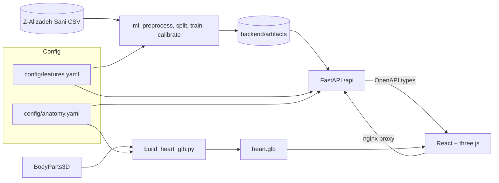

# MyoGraph 3D

MyoGraph 3D turns routine clinical data into an interactive 3D view of coronary artery disease (CAD)
risk. From 49 clinical inputs (demographics, history, symptoms, ECG, labs, echo; BMI and obesity are
derived, giving 55 model columns) it estimates the probability of overall CAD and of significant
stenosis in the LAD, LCX and RCA, then maps each probability onto the matching vessel of a 3D heart,
with a per-feature explanation of why. It is a hackathon research prototype built on the Extension of
the Z-Alizadeh Sani dataset (303 patients).

> **Disclaimer:** MyoGraph 3D is a research demo, not a medical device. Outputs are model estimates
> of probability learned from a small public dataset and must not be used for clinical decisions.


## Features

- **Live predictions:** edit any input and the four calibrated probabilities update immediately.
- **3D vessel mapping with rotate-to-vessel:** each target is coloured on the heart *and* labelled with
  its number; selecting a vessel rotates the camera to it (e.g. the LCX, which hides behind the heart).
- **SHAP "why" panel:** per-feature contributions that sum exactly to the calibrated logit.
- **Physiological breakdown:** each measurement against its reference range, with out-of-range warnings.
- **Plain-language summary:** deterministic template, optionally reworded by Groq when a key is set.
- **Validation tab:** CV and hold-out metrics, calibration, ROC, and stability across 20 random splits.


## Quick start (Docker)

Prerequisites: Docker with Compose v2.

```bash
docker compose up --build      # or: make docker
```

Open <http://localhost:8080>. No other setup is needed; the trained models are committed.

The first `docker compose up --build` downloads base images and can take about 10 minutes; later starts take under a minute.

Optional: to have the summary reworded by an LLM, `cp .env.example .env`, set `GROQ_API_KEY`, and
restart. Without a key the app uses the built-in template summary.

## Development setup (Linux / macOS / WSL2)

Requirements: [uv](https://docs.astral.sh/uv/), Node.js LTS, make. Python 3.14 is installed by uv.

```bash
make setup   # backend + frontend dependencies
make dev     # API on :8000, web on :5173
```

| Target | What it does |
|---|---|
| `make setup` | Install backend (uv) and frontend (npm) dependencies |
| `make dev` | Run API (:8000) and web (:5173) together |
| `make train` | Prepare data, retrain, regenerate all artifacts (deterministic) |
| `make stability` | Re-run the 20-seed split stability study |
| `make assets` | Rebuild `heart.glb` from BodyParts3D |
| `make types` | Regenerate TypeScript API types from the OpenAPI schema |
| `make fmt` / `make lint` | Format / lint backend and frontend |
| `make test` | Backend tests |
| `make check` | Lint, tests and type-check |
| `make screenshots` | Capture UI screenshots with Playwright |
| `make docker` | `docker compose up --build` (http://localhost:8080) |

## Architecture



The design is config-driven. `config/features.yaml` is the single source of truth for inputs, groups,
reference ranges and targets; `config/anatomy.yaml` links each target to a mesh in the heart model. The
backend and frontend derive everything from them and from the artifacts, with no hard-coded feature or
vessel lists. Models implement a small `RiskModel` interface (`fit`, `predict_proba`, `explain`,
`save`/`load`) in `backend/ml/models/`.

- **Add a feature:** add an entry to `features.yaml`, run `make train` and `make types`.
- **Add a model:** implement `RiskModel` in `backend/ml/models/`, decorate it with `@register("name")`, and set `MODEL_NAME` in `ml/train.py` and `app/services/predictor.py`.
- **Add an anatomical structure or vessel:** add a target to `features.yaml` and a node with its
  BodyParts3D ids in `anatomy.yaml`, then `make assets`.

## Results

Stratified 80/20 hold-out (seed 42); tuning and cross-validation use the training split only.
Probabilities are calibrated.

| Target | CV ROC-AUC (mean ± std) | Hold-out ROC-AUC | Hold-out Brier |
|---|---|---|---|
| Overall CAD | 0.932 ± 0.030 | 0.824 | 0.174 |
| LAD stenosis | 0.835 ± 0.054 | 0.804 | 0.183 |
| LCX stenosis | 0.729 ± 0.080 | 0.783 | 0.204 |
| RCA stenosis | 0.698 ± 0.058 | 0.695 | 0.205 |

Cross-validation is 5-fold repeated 3 times on the training split. Across 20 random splits the seed-42
split is the hardest for overall CAD (hold-out ROC-AUC 0.824 against a median of 0.911), so the hold-out
number is a conservative estimate.

**Serving throughput** (`scripts/load_test.py`, laptop, WSL2 Docker, 500 `POST /api/predict` at 20 concurrent,
0 errors): about **59 predictions/s** at 20 concurrent, with 0 errors. The 340 ms median / 462 ms p95 latency
reported under that load is queueing, not per-request cost: by Little's law, 20 in flight / 59 req/s is about
0.34 s. A single request on an otherwise idle server takes about 20–35 ms. With the 300 ms input debounce, one
person editing the form sends at most about 3 requests/s.

## Reproducing

```bash
make train       # deterministic: fixed seeds, single-threaded XGBoost
make stability   # 20-seed split stability study
make assets      # rebuild the 3D heart (needs BodyParts3D, below)
```

`make assets` needs two files from the BodyParts3D 4.0 download page,
<https://dbarchive.biosciencedbc.jp/en/bodyparts3d/download.html>, placed in `data/raw/bp3d/`
(git-ignored):

- `isa_BP3D_4.0_obj_99.zip` (about 143 MB; used in place, no extraction)
- `isa_parts_list_e.txt`

## Limitations

- 303 patients from a single centre; no external validation, so results may not transfer.
- Per-vessel targets are weaker than overall CAD (see the table), and the hold-out set is small (61 rows).
- Labels are angiographic stenosis; the model estimates probability and is not a diagnostic tool.
- The 3D heart is a schematic anatomical model, not patient-specific imaging.
- Inputs outside the training range are flagged but still scored.

## Credits and licenses

- **Dataset:** Alizadehsani, R., Roshanzamir, M., & Sani, Z. (2013). *Extension of Z-Alizadeh Sani
  dataset* [Dataset]. UCI Machine Learning Repository. <https://doi.org/10.24432/C5461K>. CC BY 4.0.
- **3D anatomy:** BodyParts3D, © The Database Center for Life Science, licensed under CC Attribution 4.0
  International. The derived `frontend/public/models/heart.glb` is released under
  [CC BY-SA 4.0](https://creativecommons.org/licenses/by-sa/4.0/); see
  `frontend/public/models/LICENSE-ASSETS.md`.
- **Code:** MIT (see `LICENSE`).
