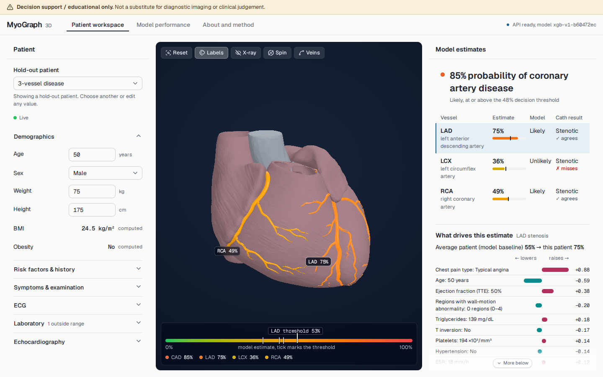
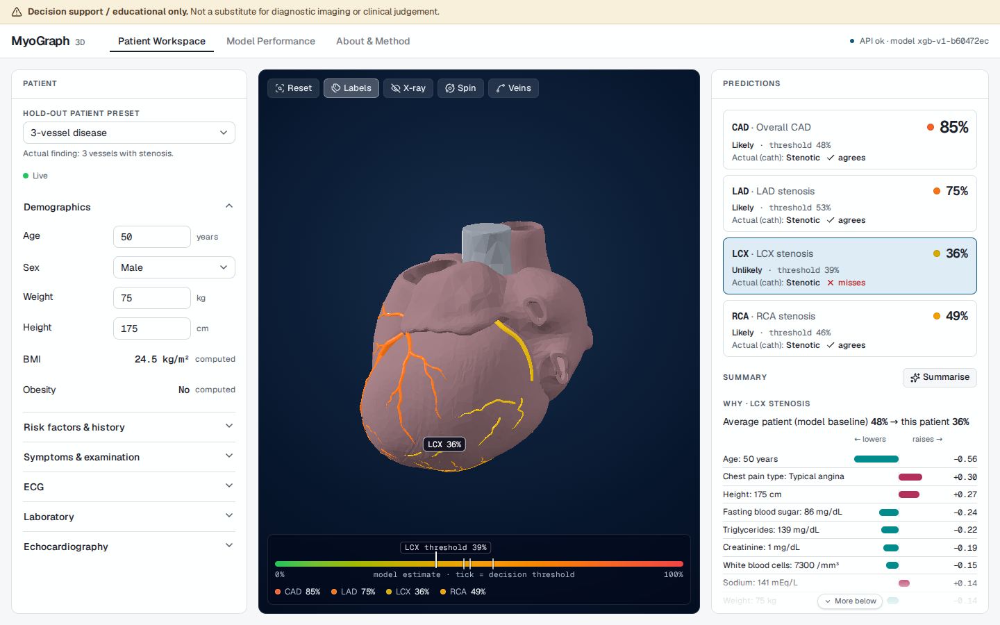
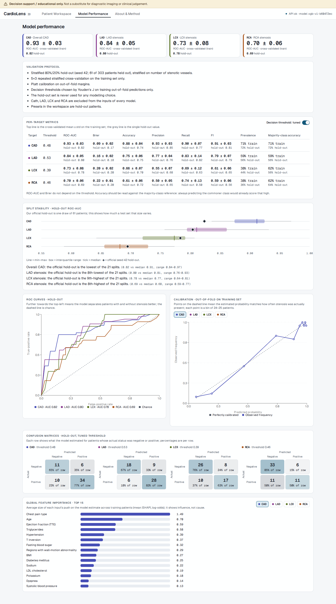
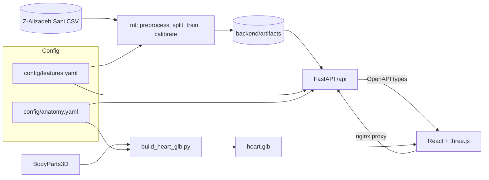

# MyoGraph 3D

MyoGraph 3D turns routine clinical data into an interactive 3D view of coronary artery disease (CAD)
risk. From 49 clinical inputs (demographics, history, symptoms, ECG, labs, echo; BMI and obesity are
derived, giving 55 model columns) it estimates the probability of overall CAD and of significant
stenosis in the LAD, LCX and RCA, then maps each probability onto the matching vessel of a 3D heart,
with a per-feature explanation of why. It is a hackathon research prototype built on the Extension of
the Z-Alizadeh Sani dataset (303 patients).

**Demo video:** <https://youtu.be/UWsbB-3spT4>

> **Disclaimer:** MyoGraph 3D is a research demo, not a medical device. Outputs are model estimates
> of probability learned from a small public dataset and must not be used for clinical decisions.



## Live demo

**<https://myograph-3d.netlify.app/>**

The app is hosted for free: the frontend on Netlify, the API on Render (free tier). The API sleeps when
idle, so the first load can take about a minute while it wakes up. If the first prediction fails, wait a
few seconds and refresh. Deploy config lives in `render.yaml` and `netlify.toml`.

## Features

- **Live predictions:** edit any input and the four calibrated probabilities update immediately.
- **3D vessel mapping with rotate-to-vessel:** each target is coloured on the heart *and* labelled with
  its number; selecting a vessel rotates the camera to it (e.g. the LCX, which hides behind the heart).
- **SHAP "why" panel:** per-feature contributions that sum exactly to the calibrated logit.
- **Physiological breakdown:** each measurement against its reference range, with out-of-range warnings.
- **Plain-language summary:** deterministic template, optionally reworded by Groq when a key is set.
- **Validation tab:** CV and hold-out metrics, calibration, ROC, and stability across 20 random splits.





## Setup

There are two routes. **Docker** is the quickest way to run the app. **Local development** is for
changing code. Either way you need a browser with WebGL (any current Chrome, Edge, Firefox or Safari);
no GPU is required; the 3D view runs with software rendering too.

### Requirements

| Tool | Minimum | Install | Docker route | Local dev route |
|---|---|---|---|---|
| Git | any recent | [git-scm.com/downloads](https://git-scm.com/downloads) | yes | yes |
| Docker Desktop (Windows, macOS) or Docker Engine (Linux), with Compose v2 | Compose 2.24 | [Docker Desktop](https://docs.docker.com/desktop/), [Docker Engine](https://docs.docker.com/engine/install/), [Compose](https://docs.docker.com/compose/install/) | yes | no |
| uv | 0.13 (the version the Docker image uses) | [docs.astral.sh/uv](https://docs.astral.sh/uv/getting-started/installation/) | no | yes |
| Node.js LTS (includes npm) | 20.19 or 22.12+ | [nodejs.org/en/download](https://nodejs.org/en/download) | no | yes |
| make | any | Linux: `sudo apt install build-essential`; macOS: `xcode-select --install` | no | yes (not needed on native Windows, see below) |

You do not install Python yourself: uv reads `backend/.python-version` and installs Python 3.14.4.
The trained models and `frontend/public/models/heart.glb` are committed, so running the app needs no
training and no downloads beyond the dependencies.

### Quick start with Docker (Linux, macOS, Windows)

```bash
git clone https://github.com/Sam-Titan/MyoGraph-3D.git
cd MyoGraph-3D
cp .env.example .env            # optional, only for the Groq summary (see below)
docker compose up --build       # or: make docker
```

Open <http://localhost:8080>. The first build downloads base images and installs dependencies and
takes several minutes; later starts take under a minute. On Windows use `Copy-Item .env.example .env`
in PowerShell instead of `cp`.

### Local development on Linux and macOS

```bash
make setup    # backend (uv sync --extra assets) and frontend (npm install) dependencies
make dev      # API on http://localhost:8000, web on http://localhost:5173
make check    # ruff, biome, pytest and tsc; run before committing
```

Open <http://localhost:5173>. The Vite dev server proxies `/api` to the API on port 8000, so start both
(`make dev` does). `make dev` stops both with Ctrl+C.

### Windows, option 1 (recommended): WSL2

1. In an administrator PowerShell run `wsl --install`, then reboot if asked and finish creating the
   Linux user. This installs Ubuntu under WSL2 by default.
2. In Docker Desktop, open Settings, Resources, WSL integration and enable your distribution (only needed
   for the Docker route).
3. Open the Ubuntu terminal and install the tools from the Requirements table inside Linux
   (`sudo apt update && sudo apt install git build-essential curl`, then uv and Node.js from their
   install pages).
4. Clone **inside the Linux home directory** (for example `~/projects`), not under `/mnt/c`. Files under
   `/mnt/c` are served through a slow cross-OS filesystem layer, which makes `npm install`, `uv sync` and
   file watching (hot reload) very slow or unreliable.
5. Follow *Local development on Linux and macOS* above, or the Docker quick start. Browse to
   `http://localhost:5173` (or `:8080`) from Windows as usual.

### Windows, option 2: native PowerShell without make

> **Not tested on Windows; WSL2 or Docker recommended.** The commands below are the ones `make setup`
> and `make dev` run. A dry-run resolution of the backend lockfile for `x86_64-pc-windows-msvc` on
> Python 3.14 found a prebuilt wheel for every backend package (including the optional `assets`
> extra), so no compiler should be needed. If a package ever lacks a Windows wheel, use WSL2 or Docker.

Install uv, Node.js LTS and Git (see the table; make is not needed), then:

```powershell
git clone https://github.com/Sam-Titan/MyoGraph-3D.git
cd MyoGraph-3D

# one-time setup (what `make setup` runs)
cd backend
uv sync --extra assets
cd ..\frontend
npm install
cd ..
```

Then run the API and the web server in two separate PowerShell windows, both from the repo root
(what `make dev` runs):

```powershell
# terminal 1: API on :8000
cd backend
uv run uvicorn app.main:app --reload --port 8000
```

```powershell
# terminal 2: web on :5173 (proxies /api to :8000)
cd frontend
npm run dev
```

Open <http://localhost:5173>. The equivalent of `make check` is `cd backend; uv run ruff check .;
uv run ruff format --check .; uv run pytest` followed by `cd ..\frontend; npm run lint; npm run typecheck`.

### Optional: Groq plain-language summary

The summary is a deterministic template by default and the app is fully usable without a key. To have
Groq reword it, create `.env` at the **repo root** (copy `.env.example`) and set:

```
GROQ_API_KEY=your-key
GROQ_MODEL=            # optional; leave empty for the default
```

Restart the API (`docker compose up -d` again, or restart `make dev`). Only the summary facts
(percentages, verdicts, top factors) are sent to Groq. `.env` is git-ignored; never commit it.

### Optional and advanced

| Command | What it does |
|---|---|
| `make train` | Prepare data, retrain and regenerate every artifact in `backend/artifacts/`; deterministic (fixed seed 42, single-threaded XGBoost) |
| `make stability` | Re-run the 20-seed split stability study |
| `make assets` | Rebuild `frontend/public/models/heart.glb` from BodyParts3D (needs the download below) |
| `make types` | Regenerate the TypeScript API types from the OpenAPI schema |
| `make fmt` / `make lint` / `make test` | Format / lint / backend tests |
| `make screenshots` | Capture UI screenshots with Playwright; needs `make dev` running and a one-time `cd frontend && npx playwright install chromium` (add `--with-deps` on Linux if system libraries are missing) |
| `make report` | Refresh the generated numbers in `docs/REPORT.md` and render `docs/REPORT.pdf`; needs `python3` with PyYAML, uv, Node, and the Playwright Chromium above |

`make assets` needs two files from the BodyParts3D 4.0 download page,
<https://dbarchive.biosciencedbc.jp/en/bodyparts3d/download.html>, placed in `data/raw/bp3d/`
(git-ignored; never commit it):

- `isa_BP3D_4.0_obj_99.zip` (about 143 MB; used in place, no extraction)
- `isa_parts_list_e.txt`

### Troubleshooting

- **Port already in use** (8000, 5173 or 8080). Stop whatever holds the port, or for Docker change the
  left side of `"8080:80"` in `docker-compose.yml`. Find the process with `ss -ltnp | grep :8000`
  (Linux), `lsof -i :8000` (macOS) or `netstat -ano | findstr :8000` (Windows). Vite moves to the next
  free port on its own; the API port must stay 8000 because the dev proxy points there.
- **Docker is not running / `docker compose` cannot connect.** Start Docker Desktop (or
  `sudo systemctl start docker` on Linux). On Windows with WSL2, enable your distribution under
  Settings, Resources, WSL integration in Docker Desktop and restart the terminal.
- **Slow installs or broken hot reload under `/mnt/c`.** Move the clone into the Linux home directory
  (`~/projects`) and work there.
- **Blank or black 3D view.** Check that WebGL is available (open `chrome://gpu` in Chrome, `edge://gpu` in Edge) and
  that hardware acceleration is enabled in the browser settings; try another browser. The rest of the
  page works without 3D.
- **CRLF line-ending errors** (for example `\r: command not found` or shell scripts failing). The
  repository's `.gitattributes` forces LF, so a fresh clone is correct. If files were checked out with
  CRLF, delete the folder and clone again.

## Architecture



The design is config-driven. `config/features.yaml` is the single source of truth for inputs, groups,
reference ranges and targets; `config/anatomy.yaml` links each target to a mesh in the heart model. The
backend and frontend derive everything from them and from the artifacts, with no hard-coded feature or
vessel lists. Models implement a small `RiskModel` interface (`fit`, `predict_proba`, `explain`,
`save`/`load`) in `backend/ml/models/`.

- **Add a feature:** add an entry to `features.yaml`, run `make train` and `make types`.
- **Add a model:** implement `RiskModel` in `backend/ml/models/`, decorate it with `@register("name")`, and set `MODEL_NAME` in `ml/train.py` and `app/services/predictor.py`.
- **Add an anatomical structure or vessel:** add a target to `features.yaml` and a node with its
  BodyParts3D ids in `anatomy.yaml`, then `make assets`.

## Results

Stratified 80/20 hold-out (seed 42); tuning and cross-validation use the training split only.
Probabilities are calibrated.

| Target | CV ROC-AUC (mean ± std) | Hold-out ROC-AUC | Hold-out Brier |
|---|---|---|---|
| Overall CAD | 0.932 ± 0.030 | 0.824 | 0.174 |
| LAD stenosis | 0.835 ± 0.054 | 0.804 | 0.183 |
| LCX stenosis | 0.729 ± 0.080 | 0.783 | 0.204 |
| RCA stenosis | 0.698 ± 0.058 | 0.695 | 0.205 |

Cross-validation is 5-fold repeated 3 times on the training split. Across 20 random splits the seed-42
split is the hardest for overall CAD (hold-out ROC-AUC 0.824 against a median of 0.911), so the hold-out
number is a conservative estimate.

**Serving throughput** (`scripts/load_test.py`, laptop, WSL2 Docker, 500 `POST /api/predict` at 20 concurrent,
0 errors): about **59 predictions/s** at 20 concurrent, with 0 errors. The 340 ms median / 462 ms p95 latency
reported under that load is queueing, not per-request cost: by Little's law, 20 in flight / 59 req/s is about
0.34 s. A single request on an otherwise idle Docker stack (50 sequential calls after warm-up, three runs) took a median of 38–45 ms and a p95 of 51–61 ms. With the 300 ms input debounce, one
person editing the form sends at most about 3 requests/s.

## Limitations

- 303 patients from a single centre; no external validation, so results may not transfer.
- Per-vessel targets are weaker than overall CAD (see the table), and the hold-out set is small (61 rows).
- Labels are angiographic stenosis; the model estimates probability and is not a diagnostic tool.
- The 3D heart is a schematic anatomical model, not patient-specific imaging.
- Inputs outside the training range are flagged but still scored.

## Credits and licenses

- **Dataset:** Alizadehsani, R., Roshanzamir, M., & Sani, Z. (2013). *Extension of Z-Alizadeh Sani
  dataset* [Dataset]. UCI Machine Learning Repository. <https://doi.org/10.24432/C5461K>. CC BY 4.0.
- **3D anatomy:** BodyParts3D, © The Database Center for Life Science, licensed under CC Attribution 4.0
  International. The derived `frontend/public/models/heart.glb` is released under
  [CC BY-SA 4.0](https://creativecommons.org/licenses/by-sa/4.0/); see
  `frontend/public/models/LICENSE-ASSETS.md`.
- **Code:** MIT (see `LICENSE`).
